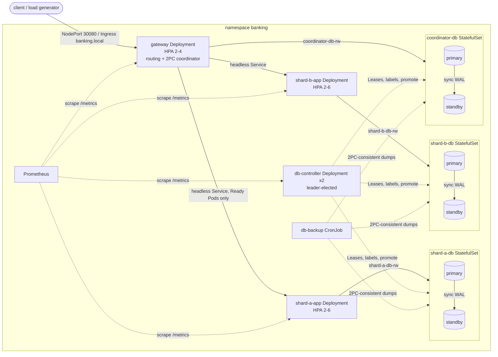

# Fault-Tolerant Distributed Banking on Kubernetes — Technical Report

Distributed Systems, Assignment 3 · Reza Nobakht (404724008)

Source, manifests, scripts and raw results:
[GitHub repository](https://github.com/rezanobakht1378/DistributedSysyems_Assignment-1-Mini-Banking-Transaction-Server).
Commands are in [README.md](./README.md); the recorded walkthrough is in
[DEMO.md](./DEMO.md).

## 1. Architecture and Kubernetes deployment

The Assignment 2 platform has these parts:
- two account shards: A0001–A1000 on shard A and A1001–A2000 on shard B;
- several application replicas per shard;
- a shard-aware gateway that also coordinates cross-shard transfers with
  two-phase commit (2PC);
- a PostgreSQL database per shard, plus one for the coordinator.

It runs unchanged on Kubernetes. Every object is declared in
[k8s/base](./k8s/base) and applied with kustomize. The three-VM variant is
the overlay [k8s/overlays/multi-vm](./k8s/overlays/multi-vm).

| Resource | Kind | Purpose |
|---|---|---|
| `gateway` | Deployment + HPA (2–4), PDB | external entry point, shard routing, 2PC coordinator |
| `shard-a-app`, `shard-b-app` | Deployment + HPA (2–6), PDB | stateless shard application replicas |
| `shard-a-db`, `shard-b-db`, `coordinator-db` | StatefulSet (2 Pods; 3 on the multi-VM overlay), PVC per Pod, PDB | PostgreSQL 16 primary + streaming standbys |
| `<db>` (headless), `<db>-rw` | Service | per-Pod DNS for replication; `-rw` selects the Pod labelled `db-role=primary` |
| `shard-*-app` (headless), `gateway` | Service | Ready-Pod discovery; NodePort 30080 for the gateway |
| `banking` | Ingress | host `banking.local` → gateway |
| `db-controller` | Deployment (2, leader-elected) | database leader records, failover, fencing, standby placement |
| `db-backup` | CronJob + PVC | logical backups every 15 min |
| `banking-config`, `banking-shard-map`, `banking-db-credentials` | ConfigMap, ConfigMap, Secret | configuration, shard ownership, passwords |
| `prometheus` | Deployment + ConfigMap | metrics and alert rules |

**Storage.** Every database Pod has its own 1 GiB ReadWriteOnce PVC from a
`volumeClaimTemplate`, so data survives Pod deletion and rescheduling. On a
single node this uses Minikube's hostPath provisioner. The multi-VM overlay
uses the node-local `local-path` StorageClass, which gives each copy
independent disk on its own worker. The backup CronJob writes to separate
PVCs, one per worker.

**Routing that survives Pod changes.**
- The shard map is a single ConfigMap mounted by both the gateway and the
  shard apps, so they can never disagree about which shard owns an account.
- The gateway resolves each shard's *headless* Service. DNS returns only
  Ready Pods, and the gateway re-resolves at most once per second. New Pods
  from scaling or updates join automatically, and unready or deleted Pods
  leave.
- The gateway checks `/health` before using a replica and retries a refused
  connection on another one.
- A request that may already have been applied is never re-sent elsewhere.
  The gateway returns `503 upstream_timeout`, and the client retries with the
  same `X-Request-ID`.
- Applications never address a database Pod directly. They use the
  `<db>-rw` Service with `target_session_attrs=read-write`, and that Service
  follows the `db-role=primary` label the controller maintains.

## 2. Shard distribution and service communication

1. The client sends `POST /transactions` with an `X-Request-ID`, or
   `GET /balance/inquiry?account=…`, to the gateway's NodePort or Ingress.
2. The gateway maps each account to its shard and forwards a balance,
   deposit, withdrawal or same-shard transfer to one Ready replica of that
   shard. The response carries `X-Gateway-Replica` and `X-Backend-Replica`.
3. The shard app runs the operation in one PostgreSQL transaction:
   - a per-request advisory lock and an idempotency row in `bank_operations`
     make retries return the stored answer;
   - row locks serialize concurrent changes to one account;
   - every change appends a hash-chained row to `bank_transactions` with the
     balance before and after.
4. A cross-shard transfer is coordinated by the gateway with 2PC:
   1. The gateway takes the cluster-wide ownership lock (a PostgreSQL
      session advisory lock `bank-2pc:<id>`) and writes PREPARING to
      `bank_coordinated_transfers`.
   2. It asks both shards to PREPARE. Each shard persists a `prepared` row
      and reserves the funds.
   3. It durably records COMMIT or ABORT.
   4. It tells both participants, and then records COMMITTED or ABORTED.
5. If the owning gateway dies, its database session ends, and with it the
   advisory lock. The recovery loop of any other gateway then finishes the
   transfer from the coordinator log:
   - PREPARING is aborted (presumed abort);
   - COMMIT is completed.
   `GET /transactions/{id}` reports the state at any time.

Only the gateway is reachable from outside. NetworkPolicies, enforced by
Calico, restrict the rest: each shard app reaches only its own database, and
the gateway reaches the shard apps and the coordinator database, never a
shard database.

## 3. Database replication and persistence

**Replication.**
- Each database is a StatefulSet whose standbys are PostgreSQL physical
  replicas, cloned with `pg_basebackup` and fed by WAL streaming.
- Commits are **synchronous**: `synchronous_commit=on` with exactly one
  named synchronous standby. A commit, and therefore every success the bank
  reports, is acknowledged only after that standby has flushed the WAL.
- An isolated old primary cannot acknowledge anything, because its
  synchronous standby is gone.

**Leader record.** The Kubernetes Lease `<db>-leader` is the only source of
truth for which Pod is the primary:
- `holderIdentity` is the primary Pod, and `leaseTransitions` is the
  epoch;
- the record changes only by compare-and-swap on its `resourceVersion`, so
  exactly one failover can win;
- annotations record:
  - the standby last observed as `sync` (`synced-standby`);
  - the primary's WAL timeline;
  - a `promoting` flag.

Each database Pod's init container reads the Lease. A Pod that is not the
leader starts as a standby, and it keeps its data only if it was following
the same leader in the same epoch. Otherwise it re-clones.

**db-controller.**
- Two replicas, one per worker on the multi-VM overlay. Only the holder of
  the `db-controller` Lease acts. The holder stops acting 6 s after its last
  successful renewal, and a peer takes over only after 10 s without change,
  so two controllers never act at once.
- It probes each member by Pod IP every 2 s, so probing does not depend on
  cluster DNS.
- When choosing the synchronous standby, it prefers one on another node.
  Before switching standbys it first clears the `synced-standby` record and
  records the new one only after PostgreSQL reports it as `sync`. The
  recorded standby therefore always holds every acknowledged commit.

**Failover procedure.** It runs when the primary has been unreachable for 15
s and a synchronous standby is recorded. The controller:
1. compare-and-swaps the Lease to that standby, increments the epoch, clears
   `synced-standby` and sets `promoting`;
2. fences the old primary: relabels it `replica` so it leaves the `-rw`
   Service, then deletes its Pod;
3. calls `pg_promote()` on the standby and labels it `primary`;
4. restarts the remaining standbys so they follow the new timeline.

Failover is refused when no synchronous standby is recorded, because
promoting a standby that might be behind could lose acknowledged commits.
Two more rules close the remaining gaps:
- A non-leader that runs as a primary is fenced. The only exception is when
  its timeline is *newer* than the recorded one: that proves the Lease
  itself is stale (for example, etcd restored from an old snapshot), and the
  record is moved to it instead.
- A recorded leader that is still a standby is promoted only if `promoting`
  is set.

**No duplicate or inconsistent effects.**
- Idempotency records, ledger rows and 2PC state are written in the same
  PostgreSQL transaction as the balance change, and they replicate together.
- A promoted standby therefore holds every acknowledged answer, and a client
  retry after failover returns the stored result instead of applying the
  operation again.
- Unacknowledged work on a fenced primary is discarded by re-cloning it.

## 4. Failure handling and transaction recovery

| Failure | Behaviour |
|---|---|
| App Pod crash or kill | The Deployment recreates it. Its endpoint leaves DNS when it stops being Ready; the gateway retries refused connections on other replicas. |
| Unhealthy replica | `/readyz` requires an initialized, writable database and a free request slot, so an unready replica stops receiving traffic. `/livez` does not depend on the database, so a database outage never restarts applications. |
| Primary database failure | Automatic failover to the synchronous standby (§3). Meanwhile apps answer `503 database_unavailable` and go unready, and clients retry with the same ID. The other shard keeps serving. |
| Standby failure | Commits on that shard block; correctness is preferred over availability. The controller picks another streaming standby if there is one. On the multi-VM overlay it re-clones a standby on a healthy node if the primary has had none for 20 s and a standby's node is NotReady. |
| Coordinator (gateway) crash mid-2PC | The ownership lock disappears with the session. Another gateway's recovery loop aborts PREPARING transfers and completes COMMIT decisions, retrying until both participants acknowledge. |
| Coordinator database failure | The same failover as a shard. Cross-shard transfers block meanwhile; the gateways stay Ready, because single-shard traffic does not need the coordinator. |

Application availability and database availability are reported separately:
- by readiness;
- by `bank_db_writable` and `bank_db_sync_standby_connected` for each
  cluster;
- by alerts such as `ShardReplicaNotReady`, `DatabaseNotWritable` and
  `DatabaseStandbyMissing`.

**Uncertain outcomes.** The client receives success only after the decision
is durable on the coordinator and on its synchronous standby. A client that
times out does not know the outcome; no success was reported. It can:
- retry with the same `X-Request-ID`, which returns the single stored
  outcome or `503 transaction_in_progress`;
- query `GET /transactions/{id}`.

PREPARING and COMMIT rows are always driven to a terminal state by the
recovery loop, so no cross-shard transfer stays partial.

## 5. Autoscaling and rolling updates

**Requests and limits.** Every container has requests and limits:
- gateway and shard apps: request 100m CPU / 128 Mi, limit 500m / 256 Mi;
- PostgreSQL: request 100m / 192 Mi, limit 1 CPU / 512 Mi;
- db-controller: request 50m / 64 Mi, limit 300m / 192 Mi.

The multi-VM overlay lowers the requests to fit two 2-CPU workers.

**Scaling triggers.**
- HorizontalPodAutoscalers scale on 60 % average CPU: shard apps 2–6,
  gateway 2–4.
- Scale-up is immediate; scale-down waits for a 90 s stabilization window.
- Each replica serves `BANK_MAX_CLIENTS` requests concurrently and rejects
  the excess with `server_busy`, so load turns into CPU and not into
  queues.
- Correctness does not depend on the replica count: the apps are stateless,
  locks live in PostgreSQL, and 2PC ownership is cluster-wide.

**Performance during scaling.** 2 background clients plus a 48-client burst:
- *Before:* every HPA at 2 replicas.
- *During:* at 63 s the gateway went 2 → 4 and shard-a-app 2 → 3. By 111 s
  shard-a-app was at 5 and shard-b-app at 4, and shard-b-app then reached 6.
- *After:* the shard apps returned 6 → 3 → 2, and the gateway 4 → 2, while
  2 clients kept running.
- No client retry was needed. 5013 operations were verified in the
  databases.

**Updates.**
- Deployments use `RollingUpdate` with `maxUnavailable: 0`, `maxSurge: 1`
  and `minReadySeconds: 5`.
- A terminating Pod fails readiness, sleeps 8 s in `preStop` so traffic
  moves away, then drains in-flight requests for up to 25 s.
- A 2PC transfer whose gateway is replaced mid-flight is finished by the
  recovery loop.
- A broken release (readiness never succeeds) stalls with the old Pods still
  serving; `kubectl rollout undo` restores the previous ReplicaSet.
- The database StatefulSets use `OnDelete` and are updated by deleting the
  standby and then running a planned switchover
  (`db_controller.py failover <db>`).

## 6. Security and observability

**Enforced restriction.** A default-deny ingress NetworkPolicy covers the
namespace, plus per-tier allow rules and egress rules, all enforced by
Calico. The `network-policy` experiment probes every path from inside the
Pods and gets exactly the expected matrix:
- shard-a-app → shard-b-db: **blocked**;
- gateway → any shard database: **blocked**;
- shard-a-app → shard-b-app: **blocked**;
- each app → its own database: allowed.

**Other controls.**
- Passwords are in a Secret. The applications connect as the unprivileged
  `bank_app` role.
- App and controller Pods run as non-root with a read-only root filesystem
  and every capability dropped.
- Only the db-controller and the database init containers have API
  access, scoped by RBAC to Leases, Pod labels, PVCs and (cluster-wide,
  read-only) Nodes and PVs.

**Logs.**
- One structured line per request, with request ID, replica, action,
  account, result and latency.
- 2PC state transitions and replica-discovery changes.
- Controller events: `failover_started/completed`, `fencing`,
  `standby_synchronized`, `degraded`, `standby_unreachable`, and controller
  leadership changes.

**Metrics** (scraped by Prometheus):
- requests by result, and latency;
- ready replicas;
- `bank_db_pod_up`, `bank_db_writable`, `bank_db_sync_standby_connected`,
  `bank_db_replication_lag_bytes`, `bank_db_leader_epoch`,
  `bank_db_failovers_total`, `bank_db_fenced_pods_total`,
  `bank_db_controller_leading`;
- 2PC decisions, outcomes, recovery actions and transactions by state.

Alert rules cover each failure class listed in §4.

## 7. Test methodology and results

**Workload.**
[scripts/k8s_experiments.py](./scripts/k8s_experiments.py) runs 8
closed-loop clients (6 on three VMs) through the public entry point. The mix
is deposits, same-shard transfers and about 40 % cross-shard transfers on
both shards. Every operation has its own request ID, and a client retries
with the same ID after any error until it gets a definitive answer.

**Verification against the databases.** After the load stops, the script
waits until the coordinator has no unresolved transfer. It then reads the
current primary of every database, located through the Lease, with `psql`
inside the Pod. Every run must pass all eleven checks:
1. every operation got a definitive answer;
2. no unexpected answer;
3. per request ID, exactly the ledger rows its answer implies;
4. no duplicate effect;
5. money conserved: Σbalances = before + acknowledged deposits −
   acknowledged withdrawals;
6. no negative balance;
7. each account's ledger chain is unbroken and ends at the stored balance;
8. 2PC states match the client answers;
9. no non-terminal 2PC row;
10. participants committed or aborted in pairs;
11. repeated submissions got identical answers.

**Results.** Single-node Minikube, 4 CPUs, Calico. All runs passed all
eleven checks.

| # | Experiment | Injected failure | Observed | DB/transaction-state evidence |
|---|---|---|---|---|
| 1 | App Pod failure | 5 Pods force-killed 8 s apart (2 per shard + 1 gateway) | never a second without success; 2 client retries; full strength 9.1 s after the last kill | 666 IDs / 1186 ledger rows; 239 COMMITTED + 1 ABORTED = client answers; money 5642.78 + 8.71 = 5651.49 exact |
| 2a | Shard primary failure | shard-a-db-0 frozen (`ctr task pause`) | auto-failover 21.1 s, writable 22.2 s, epoch 0→1; apps unready, not restarted; old primary rejoined in sync | 255 IDs / 450 rows on the *new* primary; 81 COMMITTED + 3 ABORTED in pairs; money 5651.49 + 2.83 = 5654.32 exact |
| 2b | Coordinator primary failure | coordinator-db-0 frozen | failover 22.4 s, epoch 0→1; gateways stayed Ready | all 87 transfers COMMITTED on the new coordinator and both shards; money 5654.32 + 3.32 = 5657.64 |
| 3 | Concurrent transactions | 20 simultaneous withdrawals of 10.90 from A0005 (109.00); 40 colliding opposite-direction transfers | exactly 10 granted, 10 `insufficient_funds`; all 40 transfers committed, no deadlock answer | A0005 = 0.00 via API *and* `accounts.balance`; 292 IDs / 510 rows; chains intact; money 5657.64 + 2.28 − 109.00 = 5550.92 |
| 4 | Coordinator interruption | owning gateway killed (found via `pg_locks`) while PREPARING, and while COMMIT was not yet sent | another gateway aborted after 17.1 s, or finished the commit after 14.7 s | aborted case: coordinator ABORTED, both participants aborted, 0 ledger rows, 0.00 moved, retry → `transaction_aborted`; committed case: COMMITTED, both committed, 1 row per shard, 1.00 moved, retry → stored success |
| 5 | Autoscaling under load | 48-client burst | HPAs 2→4 / 2→5 / 2→6, then back | 5013 IDs / 8982 rows; 1493 COMMITTED everywhere; money 5637.78 + 55.56 = 5693.34 |
| 6 | Rolling update under load | `set image` on the three Deployments | every Pod replaced; 0 retries; longest wait 2.8 s | 2101 IDs / 3775 rows; all 817 cross-shard COMMITTED, including those whose gateway was replaced; money 5693.34 + 23.64 = 5716.98 |
| 7 | Repeated client requests | per ID: original with its response lost, 16 concurrent copies, 5 replays, 1 conflicting payload | 21 byte-identical answers; conflict → 409 | ledger rows per ID 1, 2, 1+1; `bank_operations` exactly 1 per shard; 1 coordinator row; money 5716.98 + 5.20 = 5722.18 (each deposit counted once) |

The extra scenarios also passed the same checks: a network-policy matrix, a
deletion of both database Pods, a planned switchover, a rollback, and a
backup under load. The base cluster also survived disaster recovery from
backups. After the namespace and every volume were deleted, the restored
fingerprint was byte-identical:
- 6825 transfers;
- shard A: 1665.02 and 17321 ledger rows;
- shard B: 3721.17 and 16890 ledger rows.

Raw reports are in `k8s-results/`.

## 8. Limitations and observed behaviour

- **Writes block when one copy is left.** With one synchronous standby, a
  shard is writable only while two copies exist. If the standby is lost,
  commits block until another standby streams. This is the intended
  "unavailability over incorrectness". The runbook offers a manual switch to
  asynchronous replication.
- **Failover time is about 25–45 s.** It is the 15 s detection delay, plus
  controller handover (up to 10 s) when the controller leader died, plus
  promotion. Shortening the delay trades false failovers for availability.
- **Hung client connections.** A client whose TCP connection was on a
  force-killed gateway waits for its own timeout (25 s) before it retries.
- **Logical backups.** Backups are logical dumps every 15 minutes, so the
  recovery point of a *total* loss is the last backup. Losing a single node
  loses nothing, because of synchronous replication.
- **Writes stay blocked after a worker loss until a standby is re-cloned.**
  On two workers, a primary that failed over has its other copies on the dead
  worker. Writes resume only once a new standby streams: 104 s after the cut
  in Bonus I, and up to 289 s in Bonus II-A, where the volume provisioner had
  to be rescheduled first. Three workers, with one standby on each, would
  avoid the gap.
- **Node-local volumes.** `local-path` volumes die with their node, which
  is why every database keeps a copy on each worker. The provisioner is a
  single replica. Volumes on a lost node are released by deleting the
  PersistentVolume object, because its cleanup Pod could never run there. A
  standby re-cloned while its node was only unreachable leaves an orphaned
  directory on that node.
- **Minikube artefacts.**
  - Docker regenerates `/etc/hosts` when a node container restarts, so the
    scripts re-add the API-server name after `docker start`.
  - The single-replica add-ons (the volume provisioner, metrics-server) are
    patched to leave a lost node after 10 s; otherwise they wait 5 minutes.
  - Calico and CoreDNS are not in Minikube's image preload. Pulled over a
    slow link, a new node took 30 minutes to get a network, so the scripts
    side-load these images from the host.
  - `minikube node add` refuses to work once the original VM1 is gone. After
    a control-plane loss, new machines have to join with `kubeadm join`
    directly.

## 9. Bonus I: multi-VM cluster

**Cluster.**
- Minikube profile `banking-mv`, docker driver, Kubernetes 1.37, Calico.
  Three machines:
  - VM1 `banking-mv` (192.168.67.2): the control plane, tainted NoSchedule;
  - VM2 `banking-mv-m02`: worker;
  - VM3 `banking-mv-m03`: worker.

  A worker that replaces a destroyed one gets the next name (`-m04`, `-m05`,
  ...), which is why the results name other workers.
- An edge proxy outside the cluster (`scripts/edge_proxy.py`) plays the
  role of the external load balancer: gateway NodePorts on both workers,
  and the API server on 8443.
- CoreDNS runs on both workers. The control plane runs no application Pod.

**Placement.** The overlay gives each database 3 members. Per database:
- topology spread over the workers, plus pod affinity toward the primary;
- the controller's `spread` placement keeps a **local standby on the
  primary's worker** and a **synchronous standby on the other worker**.
  Each member has its own `local-path` volume on its own disk.

Independent recovery backups run per worker: CronJobs `db-backup`
(slot 1) and `db-backup-slot-2` (slot 2) write to separate node-local PVCs.

| Database | Primary | Local standby | Remote (synchronous) standby |
|---|---|---|---|
| shard-a-db | worker X | worker X | worker Y |
| shard-b-db | worker X | worker X | worker Y |
| coordinator-db | worker X | worker X | worker Y |

Each tier has replicas on both workers: gateway 2, each shard app 2, and
db-controller 2 under required anti-affinity.

**Experiment: worker interrupted under load.**
`scripts/k8s_vm_experiments.py worker-interrupt` kills the worker that holds
the most primaries with `docker kill`, a power cut. The worker stays down
for 180 s and is then powered on again. Meanwhile a sampler asks every
database member every 2 s whether it is writable.

Result (`k8s-results/vm-worker-interrupt.json`, image 1.3.5). The worker
`m04` held all three primaries and their local standbys, and each worker ran
one gateway and one replica of each shard app. `m04` was powered off for
191 s.
- **Failover.** shard-a, shard-b and the coordinator failed over to their
  synchronous standbys on `m05` 37.3 s, 41.7 s and 44.6 s after the cut.
- **Applications.** Within the 20 s toleration, the Pods of `m04` were
  replaced on `m05`, so 2 gateways and 2 replicas per shard ran there.
- **Writes resumed on the healthy worker.** Each new primary's standbys
  were on `m04`, so commits blocked. After 20 s the controller re-cloned
  one lost standby per database on `m05`, and **writes resumed 104 s after
  the cut, while `m04` was still off**. 635 operations were acknowledged
  during the outage.
- **After power-on.** The old primaries saw a newer leader in the Lease,
  were fenced and re-cloned as standbys. Full cross-worker redundancy was
  back 113 s after power-on.
- **Writable members.** At most 1 per database in every 2 s sample
  (`never_two_writable: true`).
- **Database proof.** 1353 request IDs, 1352 succeeded and 1 transfer
  aborted, with 59 retries carrying the same IDs. 2429 ledger rows. 523
  COMMITTED and 1 ABORTED transfers, participants in pairs. Money
  5445.87 + 15.75 = 5461.62, exact. All eleven checks passed.

## 10. Bonus II: disaster recovery

### Scenario A: worker destroyed with its disks

`k8s_vm_experiments.py worker-destroy` slows every cross-shard transfer down
after PREPARE and after the COMMIT decision, so transfers are certainly in
flight. It then removes the worker holding the primaries, together with its
Docker volume. Recovery uses only what survives:
1. The synchronous standbys on the other worker are promoted. They hold
   every acknowledged commit, including every COMMIT decision.
2. The script deletes the Node, which declares the machine gone. The
   controller then drops the lost members' volumes and re-clones them on
   the survivor. It deletes only the PersistentVolume objects, because the
   provisioner's cleanup would need a Pod on the dead node.
3. A new VM joins, takes the free backup slot, and receives one standby per
   database, which becomes the synchronous standby.
4. The gateways' recovery loop aborts PREPARING transfers and finishes COMMIT
   decisions on both shards. Clients that retry get the stored outcome.

Result (`k8s-results/vm-worker-destroy.json`). `m04` was destroyed 22 s
into the load; it held the three primaries, their local standbys and the
slot-1 backup volume.

| Measure | Value |
|---|---|
| In-flight transfers | 6: 1 PREPARING → ABORTED on both shards, 5 COMMIT → COMMITTED on both shards; 2 were owned by the gateway on `m04` |
| Failover to `m06` | 33.6 / 36.5 / 39.3 s |
| Synchronous standby again on `m06` | 226 s after the Node was deleted (the provisioner was on `m04` and had to move first) |
| New worker `m07` | synchronous standbys on it 385 s after it joined; backup slot 1 |
| Backups after recovery | slot 1 on `m07` and slot 2 on `m06` both succeeded |
| Writable members | ≤ 1 per database in every sample |
| DB checks | 1671 IDs, 2994 ledger rows, 660 COMMITTED / 4 ABORTED with participants in pairs, money 5505.69 + 19.44 = 5525.13; all 11 passed |

No balance or 2PC decision was touched by hand.

### Scenario B: control-plane VM destroyed

**Backup.** `k8s_multivm.py backup-control-plane` saves:
- an etcd snapshot;
- the PKI: the cluster CA, service-account keys, front-proxy and etcd CAs;
- the kubeadm configuration.

It copies the bundle to the host and to `/var/lib/banking-dr` on every
worker, and checks that each worker has the control-plane images.

**Restore on a worker.**
1. `etcdutl snapshot restore` creates a single-member etcd named after the
   worker.
2. The CA and keys are reused, so every kubelet certificate and
   service-account token stays valid. New API-server and etcd certificates
   are issued for the worker's address.
3. `kubeadm init phase control-plane all` and `etcd local` write the static
   Pods.
4. `control-plane.minikube.internal` is re-pointed on every node and the
   kubelets are restarted.
5. The dead Node is deleted.

The edge proxy already lists every node's port 8443, so the external API
address does not change. The snapshot may predate a failover. In that case
the controller's timeline rule (§3) moves the stale database Lease to the
newer primary instead of fencing it.

Result (`k8s-results/vm-control-plane-loss.json`, on a freshly built
three-VM cluster):

| Measure | Value |
|---|---|
| Backup age at destruction | 34 s (taken under load) |
| Without management | 206 s until the restore started; the API was unreachable |
| Served meanwhile | 2160 acknowledged requests; longest gap between acknowledgements in the whole run: 4.3 s |
| Restore on worker `m02` | API ready after 64 s |
| Scheduling proof | deleted shard-a Pod replaced and Ready after 38 s; a new Job completed on `m03` |
| Databases | same primaries, epochs and synchronous standbys as before; all members streaming 43 s after the restore |
| DB checks | 4001 IDs, all succeeded, 0 retries; 7176 ledger rows; 1576 COMMITTED transfers with participants in pairs; money 5350.00 + 45.74 = 5395.74; all 11 passed |

Without a control plane, Pods, Services and iptables rules stay in place.
The `db-controller` instances stop acting once they cannot renew their
Lease, and no failover is possible meanwhile, so a database that failed in
that window would stay unavailable rather than risk two primaries.
Restoring on a *new* VM would use the same steps, but Minikube's `node add`
refuses to create machines once its original VM1 is gone.
